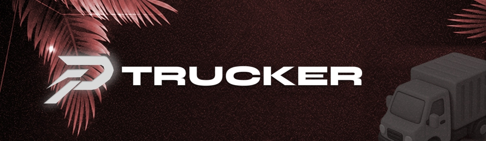
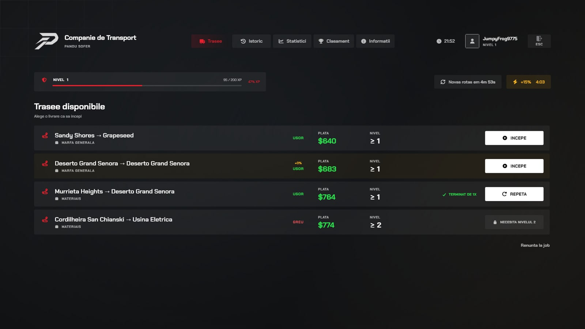
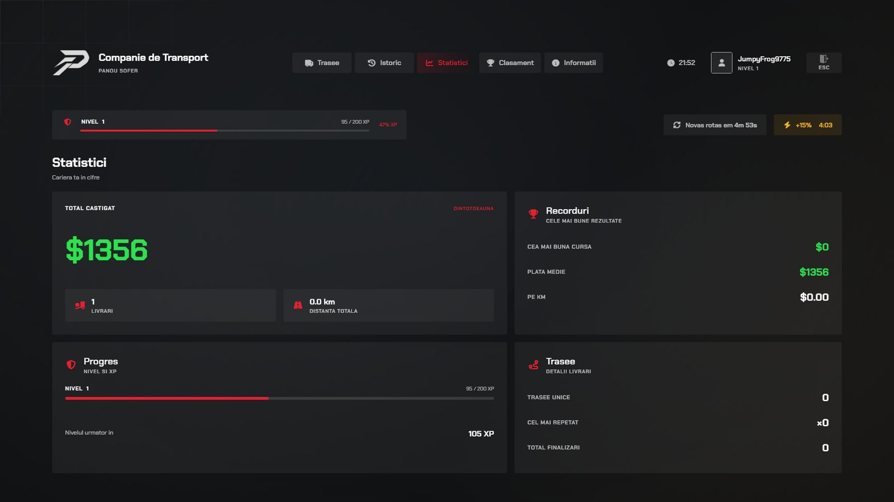
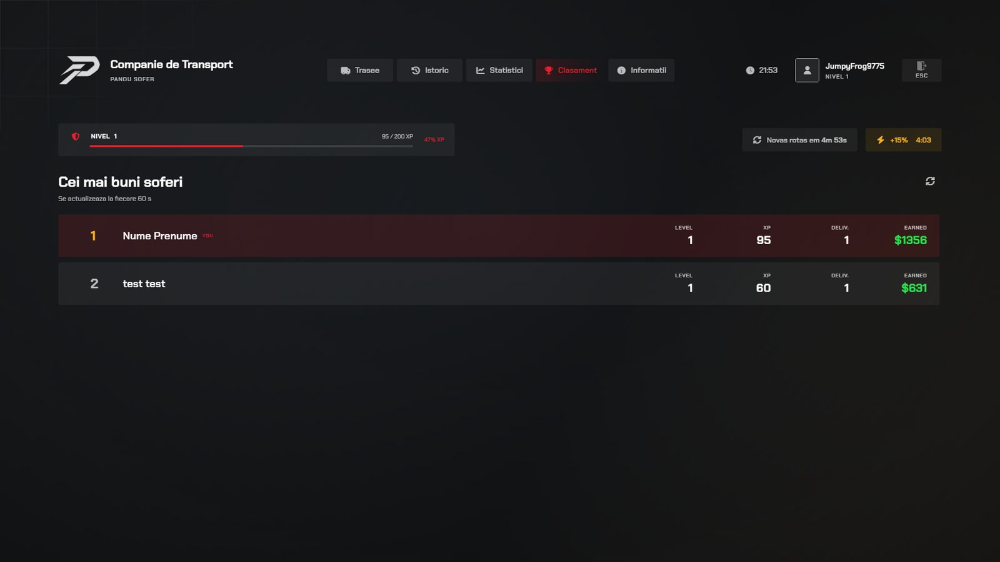
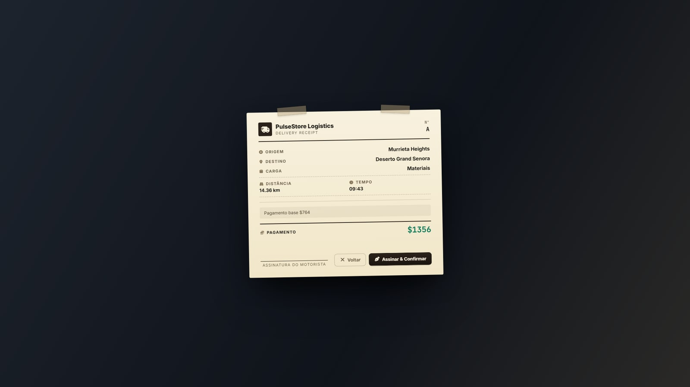
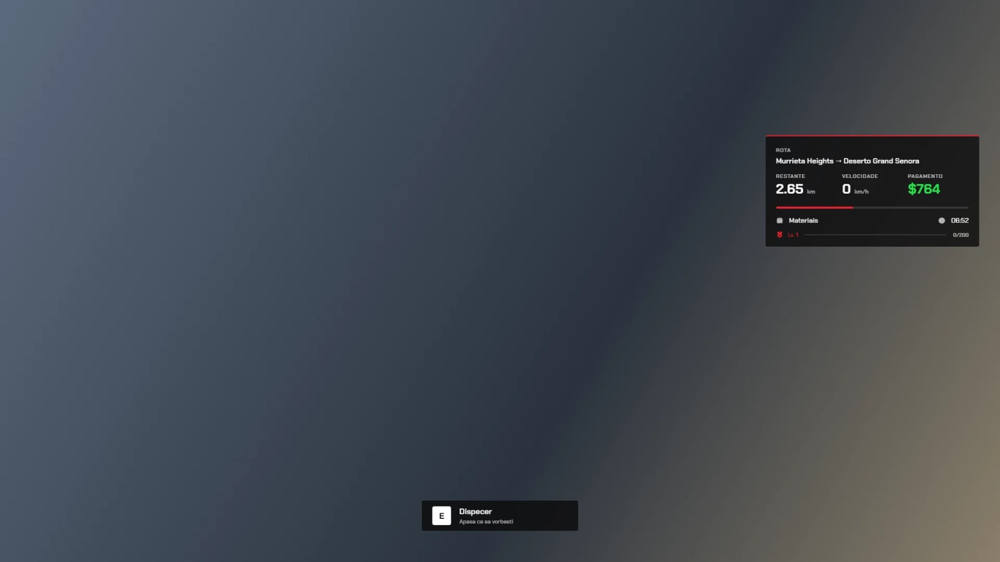

# PULSE-TRUCKER

**A complete trucker job with a dispatcher panel, XP, levels and signed delivery receipts.**

  

[**Get it on Discord**](https://discord.gg/HmjEXhPF3Q) &nbsp;•&nbsp; [**All Pulse Store products**](https://github.com/amiculap/pulse-portfolio)

> 🔒 This page is a **showcase**. The source code is private and is delivered only after purchase.

---

## Overview

PULSE-TRUCKER is a complete trucker job with a modern dispatcher panel. Admins create routes in-game with automatic pricing, level and difficulty, and drivers progress through XP and levels while a leaderboard, delivery history and detailed statistics keep track of the best.

## Preview

  
  

  
  

  

## Highlights

- 🗺️ **Routes made in-game** — Automatic pricing, level and difficulty.
- 📈 **XP & levels** — Harder, better paid routes unlock as you progress.
- 🧾 **Signed receipts** — Full payment breakdown with the receiver.
- 🏆 **Leaderboard** — Best drivers, history and statistics.
- 🛡️ **Anti-abuse** — Mission time, parked truck and distance limits.

## Features

### Framework & data

- Compatible with **vRP**, **ESX**, **QBCore**, **Qbox** and standalone
- Progress saved in **JSON** or **oxmysql**
- Multi-language: Romanian, English, Portuguese, French

### Job & progression

- Complete trucker job with a modern dispatcher panel
- Routes created in-game by admins, with automatic pricing, level and difficulty
- XP and levels: harder and better paid routes unlock as you progress
- Leaderboard with the best drivers, history of deliveries and detailed statistics

### Gameplay

- Manual trailer hitching, the route appears on the map after you couple it
- Delivery receipt signed with the receiver, with a full payment breakdown
- Bonus events and optional route rotation
- Random events: burst tyre, overheated engine, detached trailer

### Protection

- Anti-abuse protection: maximum mission time, parked truck and distance limits

### Setup

- Easy to configure and customize
- Support included after purchase

## Compatibility

| | |
| :-- | :-- |
| **Frameworks** | vRP · ESX · QBCore · Qbox · standalone |
| **Storage** | JSON or oxmysql |
| **Languages** | Romanian · English · Portuguese · French |

## What you get

- The complete resource, tested and fully functional
- Support after purchase through the official ticket system
- Free updates for bug fixes
- A license for your server / community

## Get it

**Price: 25€**

1. Join the [Pulse Store Discord](https://discord.gg/HmjEXhPF3Q)
2. Open a ticket in **#tickets**
3. Tell us what you need and get the details

Payments: bank transfer, Revolut, LTC, Paysafe.

---

[← Back to the Pulse Store portfolio](https://github.com/amiculap/pulse-portfolio) &nbsp;•&nbsp; © 2026 Pulse Store — all rights reserved. See [LICENSE](LICENSE).

